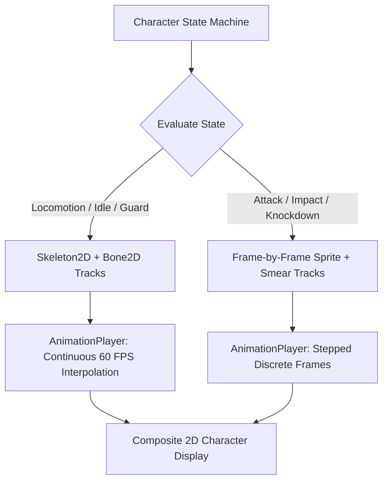

# SHADOWCRAFT 2D — ANIMATION PIPELINE & RIGGING GUIDELINES

> **Status:** APPROVED PRODUCTION STANDARD  
> **Target Frame Rate:** 60 FPS (16.6ms per tick)  
> **Source of Truth:** `docs/PROJECT_CONSTITUTION.md`

---

## 1. SKELETON2D RIGGING & HIERARCHY

Humanoid combatants use a standardized `Skeleton2D` hierarchy to ensure consistent socket attachment, inverse kinematics (where applicable), and animation retargeting across fighters:

```text
Skeleton2D (Node)
└── Bone_Root (Position: (0, 0) - Ground Origin)
    └── Bone_Pelvis (Hip origin)
        ├── Bone_Torso
        │   ├── Bone_Neck
        │   │   └── Bone_Head
        │   ├── Bone_Shoulder_Back
        │   │   └── Bone_UpperArm_Back
        │   │       └── Bone_Forearm_Back
        │   │           └── Bone_Hand_Back
        │   └── Bone_Shoulder_Front
        │       └── Bone_UpperArm_Front
        │           └── Bone_Forearm_Front
        │               └── Bone_Hand_Front
        │                   └── Socket_Weapon (Marker2D)
        ├── Bone_Thigh_Back
        │   └── Bone_Shin_Back
        │       └── Bone_Foot_Back
        └── Bone_Thigh_Front
            └── Bone_Shin_Front
                └── Bone_Foot_Front
```

### Bone Configuration Rules
- Bone rest poses (`rest` transform) must represent a balanced, upright martial stance.
- Bone lengths and angles must reflect realistic human biomechanics (e.g., knee joints do not bend backward).
- Bone rotations are interpolated smoothly using `AnimationPlayer` bezier or linear curves for neutral locomotion.

---

## 2. HYBRID ANIMATION SPECIFICATION



### Skeletal Animation Domain
- **States:** `idle`, `walk_fwd`, `walk_bwd`, `run`, `crouch_loop`, `guard_raise`, `guard_lower`.
- **Interpolation:** Continuous interpolation (`UpdateMode: Continuous`) with cubic or linear easing.
- **Cycle Lengths:**
  - `idle`: 1.2 to 1.8 seconds (breathing expansion and subtle weight shift).
  - `walk_fwd` / `walk_bwd`: 0.8 to 1.0 seconds per full stride cycle.

### Pose Ownership and Recovery
- A character's `AnimationPlayer` is the sole writer of any Bone2D property used by its state clips. Do not combine a per-frame skeletal overlay with AnimationPlayer tracks for the same bones.
- Each destination state keys every joint animated by any source state, including lower legs, feet, and forearms. A transition must restore a complete pose instead of relying on absent tracks or an abrupt skeleton reset.
- Walk cycles counter-rotate the ankle/foot against the thigh and shin chain where needed to keep the sole approximately level through stance.
- Airborne and landing poses are authored as clips in the same animation library. The controller selects clips from physics state; pose blending remains presentation logic in AnimationPlayer.
- Sprite offsets are part of the rig's ground-contact geometry. Validate both foot bottoms against the floor line in a rendered scene after changing a pivot or offset.

### Frame-by-Frame & Stepped Domain
- **States:** Attacks (`sword_light_1`, `axe_heavy_slam`), parry deflections, heavy staggers, wall impacts, knockdowns.
- **Interpolation:** Stepped (`UpdateMode: Discrete`). Keyframes are placed on exact 60 FPS frame boundaries.
- **Smears & Impact Frames:** Hand-drawn motion smears are enabled for 1 to 2 frames during maximum weapon velocity to communicate martial speed and weight.

---

## 3. FRAME TIMING & COMBAT CADENCE

Every attack animation is authored to strict 60 FPS frame timings:

| Phase | Frame Range (Typical Light Attack) | Frame Range (Typical Heavy Attack) | Engine State |
|---|---|---|---|
| **Startup** | Frames 1–6 (100ms) | Frames 1–16 (266ms) | Hitbox disabled. Input can be canceled into parry/dodge. |
| **Active** | Frames 7–9 (50ms) | Frames 17–21 (83ms) | Hitbox enabled. Collision registered on overlap. |
| **Recovery** | Frames 10–18 (150ms) | Frames 22–38 (283ms) | Hitbox disabled. Character committed; vulnerable to counter. |

- **Combo Buffer Window:** The last 4 frames of the Recovery phase allow input buffering for subsequent attacks in a combo chain.
- **Hitstop (Freeze Frames):** When an attack makes contact, both attacker and defender enter a micro-pause (2 to 6 frames) to provide tactile impact feel before resuming recovery/hitstun.

---

## 4. ANIMATION NAMING CONVENTIONS

All animations inside `AnimationPlayer` must adhere to standard slash-separated namespaces:

- `loco/idle`: Neutral breathing loop.
- `loco/walk_fwd`: Forward advance.
- `loco/walk_bwd`: Backward retreat (triggers backward guard).
- `loco/crouch_enter`, `loco/crouch_idle`, `loco/crouch_exit`.
- `loco/jump_takeoff`, `loco/jump_air`, `loco/jump_land`.
- `combat/guard_high`, `combat/guard_low`.
- `combat/parry_success`: Parry flash and opponent deflection stance.
- `combat/stagger_light`: Quick flinch.
- `combat/stagger_heavy`: Deep stumble.
- `combat/knockdown`: Fall to ground.
- `combat/wakeup_roll`: Ground recovery roll.
- `<weapon_category>/light_1`, `<weapon_category>/light_2`, `<weapon_category>/light_3`: Standard 3-hit string.
- `<weapon_category>/heavy`: High-commitment strike.
- `<weapon_category>/special`: Category-unique martial maneuver (e.g., spear retreating thrust, mace spin).

---

## 5. IMPLEMENTED KAI LOCOMOTION CYCLES (PHASE 01)

The following locomotion animations are fully implemented in `scenes/characters/Kai.tscn` under the `"loco"` AnimationLibrary:

| Animation Path | Duration | Loop | Track Count | Anatomical Characteristics |
|---|---|---|---|---|
| `loco/idle` | 1.60s | Looping | 8 tracks | Natural martial breathing bounce (hips Y=-350 to -346), subtle torso rotation (0 to 0.02 rad), compensatory head tilt (-0.02 to 0 rad), relaxed resting arm sway. |
| `loco/walk_fwd` | 1.00s | Looping | 9 tracks | Fluid martial forward stride, hips bobbing at stride apex (Y=-350 to -354), opposing leg swing (-0.30 to +0.28 rad), natural elbow flexion (0 to -0.30 rad). |
| `loco/walk_bwd` | 1.00s | Looping | 10 tracks | Cautious defensive retreat with slight forward torso lean (-0.03 rad), controlled stride width (-0.22 to +0.24 rad), arms positioned ready for guard transition. |
| `loco/crouch` | 0.50s | Looping | 13 tracks | Grounded martial crouch guard, center-of-gravity lowered (hips Y=-280), forward torso angle (-0.15 rad), head tilted up to track opponent (+0.12 rad), front arm curled tightly into face/chin guard (upper arm -0.45 rad, forearm -1.65 rad), feet flat on floor line. |

### Bone & Node Structure
All locomotion tracks animate the following standardized bone hierarchy:
- `Skeleton2D/Bone_Root` (Origin)
- `Skeleton2D/Bone_Root/Bone_Hips` (Pelvis)
- `Skeleton2D/Bone_Root/Bone_Hips/Bone_Torso`
- `Skeleton2D/Bone_Root/Bone_Hips/Bone_Torso/Bone_Head`
- `Skeleton2D/Bone_Root/Bone_Hips/Bone_Torso/Bone_Shoulder_Front` -> `Bone_Arm_Upper_Front` -> `Bone_Arm_Lower_Front` -> `Bone_Hand_Front` -> `Socket_Weapon`
- `Skeleton2D/Bone_Root/Bone_Hips/Bone_Torso/Bone_Shoulder_Back` -> `Bone_Arm_Upper_Back` -> `Bone_Arm_Lower_Back` -> `Bone_Hand_Back`
- `Skeleton2D/Bone_Root/Bone_Hips/Bone_Leg_Upper_Front` -> `Bone_Leg_Lower_Front` -> `Bone_Foot_Front`
- `Skeleton2D/Bone_Root/Bone_Hips/Bone_Leg_Upper_Back` -> `Bone_Leg_Lower_Back` -> `Bone_Foot_Back`

