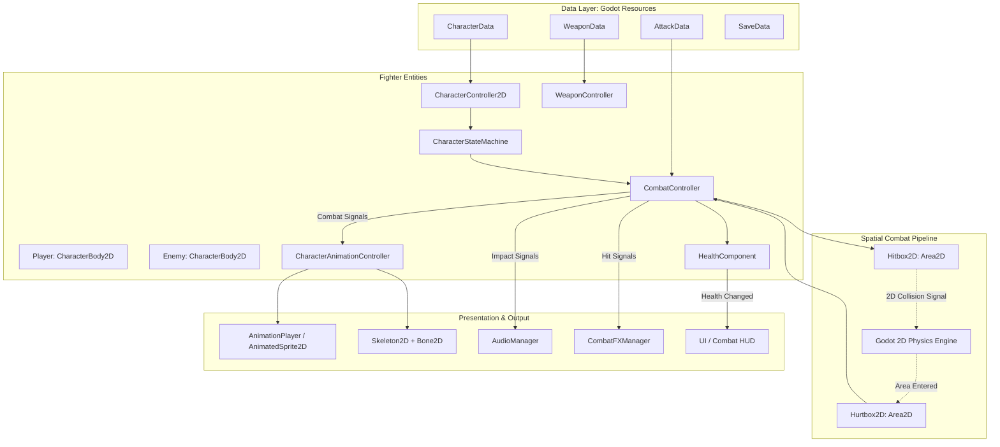
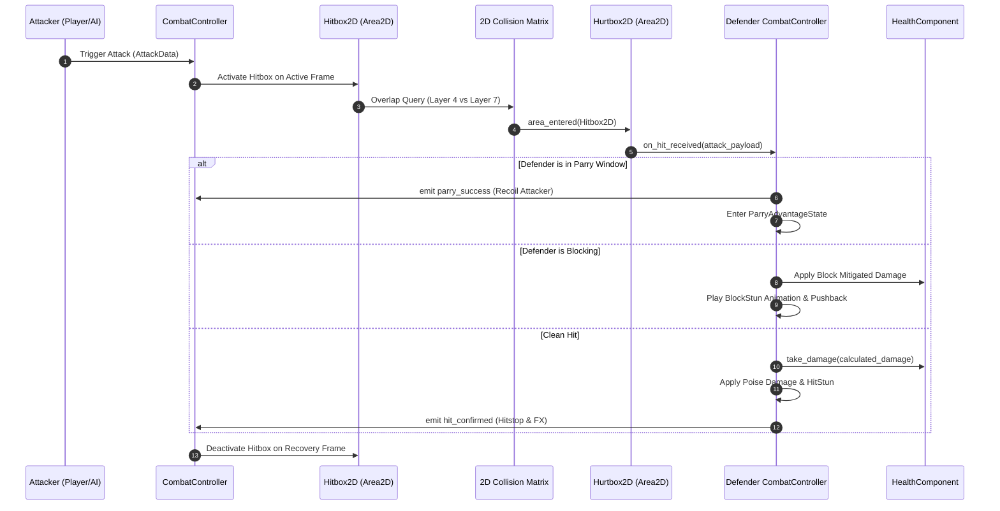
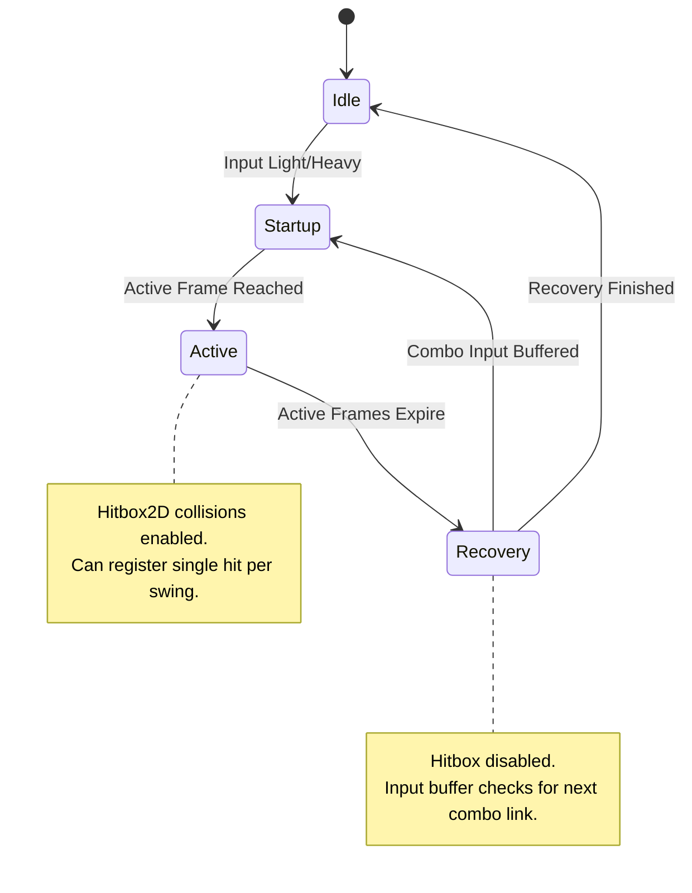
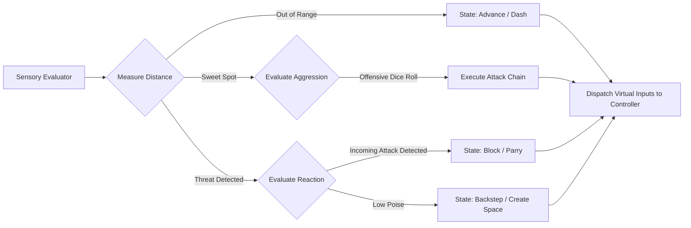
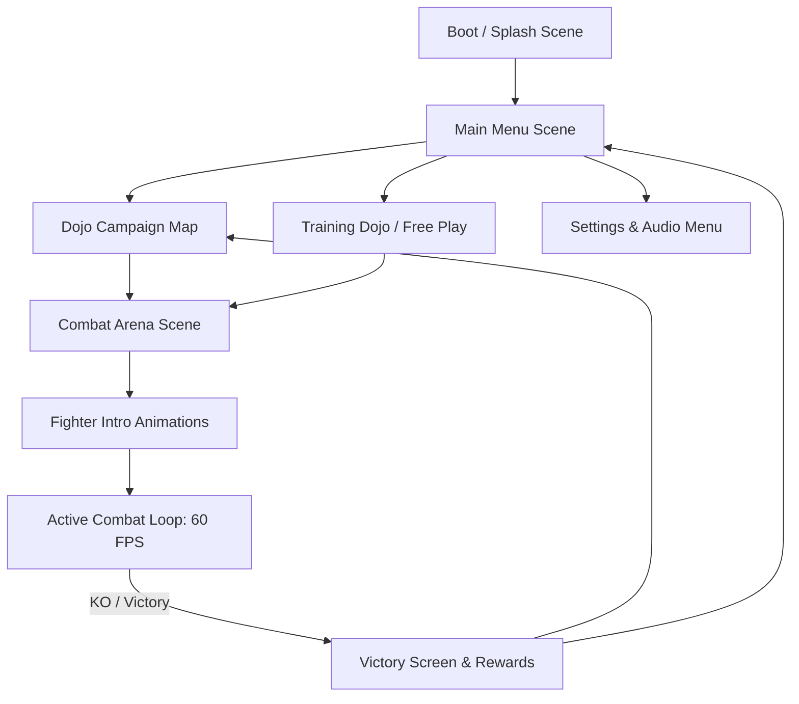

# SHADOWCRAFT 2D — TECHNICAL ARCHITECTURE BLUEPRINT

> **Status:** APPROVED BASELINE  
> **Engine:** Godot 4.7+ (GL Compatibility Renderer)  
> **Paradigm:** Modular Component-Based 2D Kinematic & Data-Driven Resources  
> **Permanent Reference:** `docs/PROJECT_CONSTITUTION.md`

---

## 1. SYSTEM OVERVIEW & ARCHITECTURAL DIAGRAM

ShadowCraft 2D is architected around a strict separation of concerns:
- **Game Logic** resides in lightweight, typed GDScript components.
- **Game Data** resides in serializable, custom Godot `Resource` definitions.
- **Presentation & Feedback** (animation, visual FX, lighting, audio) listens to engine signals and reacts without polluting combat logic.



---

## 2. CHARACTER ARCHITECTURE

Every combatant (player or AI) inherits from or instantiates a standard character structure rooted in `CharacterBody2D`.

```text
CharacterRoot (CharacterBody2D)
├── MovementCollision (CollisionShape2D)
├── Visuals (Node2D)
│   ├── Skeleton2D
│   │   ├── RootBone (Bone2D)
│   │   │   ├── TorsoBone (Bone2D)
│   │   │   │   ├── HeadBone (Bone2D)
│   │   │   │   ├── Arm_Back (Bone2D)
│   │   │   │   └── Arm_Front (Bone2D)
│   │   │   │       └── WeaponSocket2D (Marker2D)
│   │   │   └── Leg_Back / Leg_Front (Bone2D)
│   ├── BodySprites (Node2D / Sprite2D parts)
│   └── WeaponInstance (Node2D)
├── CharacterController2D (Node)
├── CharacterStateMachine (Node)
│   ├── NeutralState (Node)
│   ├── MoveState (Node)
│   ├── JumpState (Node)
│   ├── AttackState (Node)
│   ├── BlockState (Node)
│   ├── StaggerState (Node)
│   └── KnockdownState (Node)
├── CombatController (Node)
│   ├── HitboxManager (Node2D)
│   │   └── AttackHitbox (Hitbox2D - Area2D)
│   └── HurtboxManager (Node2D)
│       ├── HeadHurtbox (Hurtbox2D - Area2D)
│       ├── TorsoHurtbox (Hurtbox2D - Area2D)
│       └── LegsHurtbox (Hurtbox2D - Area2D)
├── HealthComponent (Node)
├── CharacterAnimationController (Node)
└── AnimationPlayer (AnimationPlayer)
```

### Key Components

- **`CharacterController2D`**:
  Handles raw input interpretation (or AI action dispatches), velocity calculations, gravity accumulation, and floor/wall collision responses via `move_and_slide()`. It enforces automatic opponent-facing logic:
  ```gdscript
  # Facing logic convention
  func update_facing(opponent_position_x: float) -> void:
      var should_face_right: bool = global_position.x < opponent_position_x
      if should_face_right != is_facing_right:
          is_facing_right = should_face_right
          visuals_root.scale.x = 1.0 if is_facing_right else -1.0
  ```
- **`CharacterStateMachine`**:
  A hierarchical, typed finite state machine (FSM). States define legal transitions, preventing illegal inputs (e.g., jumping during attack recovery or attacking while staggered).
- **`CharacterData` (`Resource`)**:
  Stores base statistics: `max_health: float`, `base_walk_speed: float`, `poise_max: float`, `weight_class: String`, and theme identifiers (e.g., Purple for Kai, Crimson for Razen).
- **Decoupling Movement & Combat:**
  Movement state logic operates on horizontal velocity vector manipulation; once an attack state triggers, the `CombatController` takes exclusive authority over movement impulses (root motion or lunges), preventing floating or slide-attacks.

---

## 3. COMBAT ARCHITECTURE



### Hitboxes & Hurtboxes
- **`Hitbox2D` (`Area2D`)**:
  Belongs to Physics Layer 4 (`player_hitbox`) or 5 (`enemy_hitbox`). Carries the active `AttackData` reference, current hit ID (to prevent multi-hitting on the same swing), and active status.
- **`Hurtbox2D` (`Area2D`)**:
  Belongs to Physics Layer 6 (`player_hurtbox`) or 7 (`enemy_hurtbox`). Contains high/mid/low body part classifications. Vulnerability is modified when crouching or blocking.
- **`HealthComponent`**:
  Manages `current_health`, `max_health`, `poise`, and shield durability. Emits signals:
  `health_changed(current, max)`, `poise_broken()`, and `died()`.
- **Damage Formula:**
  $$\text{Final Damage} = (\text{Base Weapon Damage} \times \text{Attack Ratio} \times \text{Material Tier Multiplier}) - \text{Armor Flat Reduction}$$
  If blocked:
  $$\text{Blocked Damage} = \text{Final Damage} \times (1.0 - \text{Block Mitigation Ratio})$$
- **Parry System:**
  Guarding within 4 frames (66ms) before active hitbox contact executes a **Parry**:
  1. Zero health damage taken.
  2. Defender takes zero blockstun.
  3. Attacker enters an extended Stumble/Recoil state (18 frames of vulnerability).
  4. Audio and visual time-freeze (hitstop) of 6 frames.

---

## 4. WEAPON ARCHITECTURE

Weapons are completely data-driven and modular.

```text
resources/weapons/
├── WeaponData.gd (Resource Definition)
├── sword/
│   ├── sword_wood.tres
│   ├── sword_iron.tres
│   └── sword_diamond.tres
├── axe/
├── spear/
└── mace/
```

### Data Schema

```gdscript
# Core Weapon Data Class Concept
class_name WeaponData
extends Resource

enum Category { SWORD, AXE, SPEAR, MACE }
enum MaterialTier { WOOD, STONE, IRON, DIAMOND, NETHERITE }

@export var weapon_id: String
@export var display_name: String
@export var category: Category
@export var material_tier: MaterialTier

@export var base_damage: float = 10.0
@export var weight_penalty: float = 1.0 # Modifies recovery frames
@export var poise_damage_multiplier: float = 1.0
@export var sprite_texture: Texture2D
@export var visual_trail_color: Color

# Moveset mappings
@export var attack_neutral_light: AttackData
@export var attack_forward_light: AttackData
@export var attack_heavy: AttackData
@export var attack_special: AttackData
```



---

## 5. ANIMATION ARCHITECTURE

ShadowCraft 2D uses a hybrid animation approach:

1. **Skeletal Rigging (`Skeleton2D` + `Bone2D`):**
   - Head, Torso, Upper Arm, Forearm, Hand (with WeaponSocket Marker2D), Thigh, Shin, Foot.
   - Interpolated in `AnimationPlayer` for seamless neutral locomotion (`idle`, `walk_forward`, `walk_backward`, `crouch_loop`).
2. **Frame-by-Frame Sprite Swaps (`AnimationPlayer` with track property swapping):**
   - Dynamic attack arcs, dramatic martial smears, and high-energy impact poses.
   - When an attack animation plays, the `AnimationPlayer` blends bone rotations and rapidly swaps weapon/limb sprite textures along keyframe intervals.
3. **Animation Naming Conventions:**
   - Locomotion: `loco/idle`, `loco/walk_fwd`, `loco/walk_bwd`, `loco/crouch`
   - Defense: `def/block_high`, `def/block_low`, `def/parry`, `def/hit_stagger`, `def/knockdown`
   - Combat: `<category>_<atk_type>` (e.g., `sword_light_1`, `sword_heavy_cleave`, `spear_thrust_fwd`)

---

## 6. ENEMY & AI ARCHITECTURE

The enemy system shares the exact same `CharacterBody2D`, `CombatController`, and `HealthComponent` pipeline as the player, ensuring consistent rules and physics.



- **Sensory Evaluation:** Measures distance to player, player's current action (attacking, recovering, blocking), and current wall proximity.
- **Difficulty Tuning:** Controlled via parameter tables (`reaction_delay_ms`, `parry_chance_percentage`, `feint_probability`, `aggression_timer`).

---

## 7. PROGRESSION & DOJO ARCHITECTURE

- **Dojo Hub & Hierarchy:**
  Players progress through martial dojos (e.g., Dojos 1 through 6). Each dojo contains:
  - 3 Bodyguard disciples.
  - 1 Master Boss (unique weapon, distinct custom behavior).
- **Campaign Map Flow:**
  Selecting a dojo opens the match arena; completing matches awards gold, shadow essence, and material blueprints.
- **Save / Load Integrity:**
  - Saved as validated JSON with internal schema versioning (`schema_version: 1`).
  - Stored in Godot's sandboxed `user://savegame.json`.
  - Cryptographic hash / HMAC verification to prevent corrupted or tampered saves.

---

## 8. SCENE FLOW & LIFECYCLE



---

## 9. NON-IMPLEMENTATION IN PHASE 00

As mandated by the Project Constitution, **no gameplay scripts, scenes, or mechanics are implemented during Phase 00**. This document serves as the permanent architectural roadmap for subsequent approved phases.

