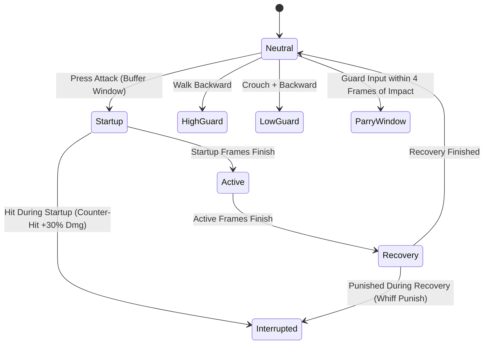

# SHADOWCRAFT 2D — COMBAT DESIGN & MECHANICS SPECIFICATION

> **Status:** APPROVED DESIGN BASELINE  
> **Target Rhythm:** Tactical, Spacing-Driven, Martial Arts Precision  
> **Source of Truth:** `docs/PROJECT_CONSTITUTION.md`

> **Implementation status (2026-11-11):** Combat 1 foundation plus the approved Combat Phase 2 Step 1 data/chain engine and Step 2 Cross/Heavy Punch slice are integrated. Defense, broader combo sequences, poise, weapons and shadow specials remain outside the completed slice.

---

## 1. COMBAT PHILOSOPHY & GAMEPLAY LOOP

ShadowCraft 2D combat is built on three core tenets:
1. **Deliberate Commitment:** Every strike carries meaningful startup and recovery. Whiffing an attack at the wrong distance creates a clear vulnerability window for the opponent.
2. **Dynamic Spacing (The Footsies Game):** Matches are won by mastering the threat range of your weapon versus the opponent's. A spear fighter dictates the match from long range; a mace or sword fighter must weave inside the thrust tip to punish.
3. **Reactive Defense & Momentum Swings:** Blocking prevents catastrophic health loss, but parrying within the critical 4-frame window turns defense directly into offensive momentum.



---

## 2. DEFENSIVE MECHANICS

### Directional Guarding
- **High Guard (Neutral Guard):**
  - Triggered by holding backward movement while standing.
  - Mitigates 75% of incoming damage from mid and high attacks.
  - Does NOT protect against low sweeps; crouching low attacks break through high guard.
- **Low Guard (Crouching Guard):**
  - Triggered by holding down-backward.
  - Mitigates 75% of incoming damage from low sweeps and mid thrusts.
  - Completely vulnerable to jumping attacks and heavy overhead chops (e.g., heavy axe cleaves).
- **Guard Chip Damage & Poise Depletion:**
  - Blocked attacks still inflict minor chip damage (10% to 25% of unblocked damage depending on weapon tier) and drain Poise.
  - When a fighter's Poise gauge reaches zero, they suffer a **Guard Break** (entering heavy stagger for 30 frames).

### The Parry System (High-Skill Deflection)
- **Execution Window:** Engaging guard within **4 frames (66.6ms)** of an incoming hitbox contacting the hurtbox triggers a **Parry**.
- **Mechanics:**
  - Zero health damage taken.
  - Zero guard meter/poise loss.
  - Attacker suffers **Recoil Stumble** (+18 frames of recovery disadvantage).
  - Triggers a 6-frame hitstop (screen freeze) accompanied by a distinct metallic clash sound and directional spark particle burst.
  - Defender immediately recovers into neutral, enabling a guaranteed punish combo.

---

## 3. DAMAGE FORMULA & COMBAT MATHEMATICS

### Damage Calculation
```text
Unmitigated Damage = (Weapon.base_damage * Attack.damage_ratio * Material.damage_multiplier) + Base_Strength
Final Damage = MAX(1.0, Unmitigated Damage - Opponent.armor_reduction)
```

### Hit Modifiers
- **Clean Hit:** Standard calculated damage.
- **Counter-Hit:** If defender is hit during the **Startup** frames of their own attack:
  - $\text{Damage} \times 1.30$ (+30% bonus damage).
  - +6 additional frames of hitstun.
- **Whiff Punish:** If defender is hit during the **Recovery** frames of their own missed attack:
  - $\text{Damage} \times 1.20$ (+20% bonus damage).
- **Blocked Hit:**
  $$\text{Chip Damage} = \text{Final Damage} \times (1.0 - \text{Mitigation Ratio})$$

### Poise & Stun System
- **Poise Pool:** Each character possesses a Poise pool (e.g., 100 points for Kai, 160 points for Razen).
- **Poise Damage:** Heavy weapons (Maces, Axes) deal high poise damage (40–70 points per strike); swords deal moderate poise damage (20–35 points).
- **Poise Regeneration:** Poise regenerates continuously after 2.0 seconds of not receiving damage or blocking attacks.

---

## 4. HIT REACTIONS & KNOCKBACK

When an unblocked attack lands, the defender enters one of four deterministic hit reactions:

1. **Light Stagger:**
   - Caused by light sword or spear pokes.
   - 12 frames of hitstun. Defender pushed back 40px.
2. **Heavy Stagger:**
   - Caused by heavy attacks, 3rd hit of combo strings, or counter-hits.
   - 24 frames of hitstun. Defender pushed back 80px.
3. **Knockdown:**
   - Caused by mace smashes, heavy axe chops, or sweep kicks.
   - Defender is thrown off their feet, landing prone on the ground.
   - Grounded state: Immune to high attacks; vulnerable to ground stomps for 10 frames before automatic roll recovery.
4. **Wall Splat:**
   - If a heavy knockback drives the opponent into the arena boundary wall, they suffer a Wall Splat (+12 frames of extra stun), allowing extended juggle combos.

---

## 5. COMBAT 1 IMPLEMENTED SLICE

- Kai V2 can perform **Light Jab** (`Z`) and **Front Kick** (`X`) while grounded and not crouched. Each action is rejected outside its neutral start state and during airborne or crouch states.
- Both attacks use distinct six-frame 512×512 atlas clips at 30 FPS, mapped to 12 fixed physics frames at 60 ticks/s. Attack-specific startup/active/recovery windows, damage, knockback, hitstun and rectangle geometry are held in `AttackData` resources.
- The player hitbox is on physics layer 4 and scans only target hurtboxes on layer 7. The training dummy uses a CharacterBody2D body on layer 3 plus a Hurtbox2D on layer 7; Kai's hurtbox is layer 6. Each target is damaged at most once per active window.
- The Combat Test Arena demonstrates these two attacks only. Buffered input, combos, blocking, dodge, poise, knockdown, aerial attacks, specials, and AI remain unimplemented.

### Combat 1.1 polish

- Light Jab and Front Kick preserve their six-frame source clips and 12-physics-frame total duration. Their six-tick startup places the two-tick active window on the authored contact pose; recovery remains four ticks.
- `AttackData.active_hitbox_offsets` provides one limb-aligned hitbox center per active frame. The Hitbox2D follows the current offset and disables at recovery.
- Confirmed damage triggers a 40ms jab or 55ms kick hit-stop, a small distinct code-drawn impact spark, and a brief eased training-dummy recoil. No camera shake or particle system is used.

### Combat Phase 2 Step 2 — Cross and Heavy Punches

- Kai V2 and Razen each use independent 30 FPS one-shot Cross Punch and Heavy Punch clips from their approved transparent 512×512 frames.
- Startup windows begin active frames at the authored contact pose (Kai Cross 6/2/4, Kai Heavy 10/2/8; Razen Cross 10/2/4, Razen Heavy 12/2/10 at 60 physics ticks/s). Each move provides two limb-aligned active-frame hitbox offsets.
- The existing input buffer supports jab (Z) → cross (Z) → heavy (C); C can also start Heavy Punch directly from neutral. This is the scoped Step 2 chain only. Step 3 Roundhouse/Sweep and wider combo content are not included.
- Static asset/resource checks pass. Godot 4.7.2 runtime and visual verification are pending because the engine executable is unavailable in this session.
