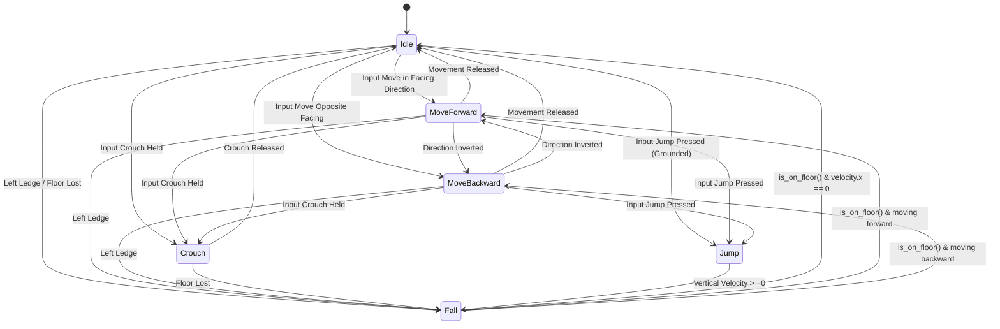

# PHASE 02 SPECIFICATION: PLAYER MOVEMENT & CONTROLS

> **Phase Identifier:** PHASE-02  
> **Target Engine:** Godot 4 (Compatibility Renderer `gl_compatibility`, 1280×720)  
> **Source of Truth:** `docs/PROJECT_CONSTITUTION.md` and `docs/ARCHITECTURE.md`  
> **Language:** GDScript 2.0 (Statically Typed)  
> **Status:** APPROVED & ACTIVE

---

## 1. OBJECTIVE & SCOPE

Implement a responsive, deterministic 2D player movement system for protagonist **Kai — The Shadow Disciple** in a side-view fighting arena using Godot 4 `CharacterBody2D` and a typed State Machine.

Movement must deliver the authentic feel of a skilled martial arts fighter:
- Snappy, responsive horizontal acceleration and deceleration (no sluggish ice-skating).
- Grounded physical presence with realistic gravity and reliable floor/wall collision.
- Clean integration with Kai's Phase 01 skeletal animations (`loco/idle`, `loco/walk_fwd`, `loco/walk_bwd`, `loco/crouch`).
- Safe handling of jumping and airborne states without fabricating unapproved animations.
- Dynamic collision height resizing during crouch.
- Automatic opponent-facing logic with independent visual flipping that preserves physics coordinates.

---

## 2. INPUT MAPPING SCHEMA

Configured cleanly in `project.godot` under `[input]`:

| Action Name | Primary Key | Secondary Key | Controller Role |
|---|---|---|---|
| `move_forward` / `move_right` | `D` | `Right Arrow` | Forward advance when facing right; retreat when facing left |
| `move_backward` / `move_left` | `A` | `Left Arrow` | Backward retreat when facing right; advance when facing left |
| `jump` | `Space` | `W` / `Up Arrow` | Vertical leap (disabled while crouched or airborne) |
| `crouch` | `S` | `Down Arrow` | Low martial crouch guard (reduces collision height, locks jump) |

All action names are configurable via exported properties on `CharacterController2D` to avoid hardcoded string dependencies.

---

## 3. MOVEMENT PHYSICS & CONSTANTS

All values are specified in standard Godot 2D pixels and seconds:

| Parameter | Default Value | Description |
|---|---|---|
| `walk_speed` | 220.0 px/s | Maximum horizontal ground walking speed (matches `CharacterData.base_walk_speed`) |
| `ground_acceleration` | 1800.0 px/s² | Rapid rate of velocity ramp-up to maximum walk speed (~0.12s to full speed) |
| `ground_friction` | 2200.0 px/s² | Snappy deceleration to neutral when input is released (~0.10s to dead stop) |
| `air_acceleration` | 800.0 px/s² | Controlled airborne trajectory adjustment |
| `jump_velocity` | -420.0 px/s | Instantaneous upward vertical impulse (~90px peak jump height) |
| `gravity` | 980.0 px/s² | Standard downward gravity acceleration |
| `max_fall_speed` | 1200.0 px/s | Terminal downward falling velocity |
| `standing_collision_height` | 320.0 px | Full-body standing collision capsule height |
| `crouch_collision_height` | 200.0 px | Lowered crouch collision capsule height |
| `collision_radius` | 28.0 px | Lateral thickness of character bounding volume |

---

## 4. FINITE STATE MACHINE (FSM)

The character movement lifecycle is governed by an explicit State Machine:



### State Behavior Rules:
1. **`Idle`**: Horizontal velocity decelerates to 0 via friction. Plays `loco/idle`.
2. **`MoveForward`**: Accelerates up to `walk_speed`. Plays `loco/walk_fwd`.
3. **`MoveBackward`**: Accelerates up to `walk_speed * 0.85` (defensive retreat pace). Plays `loco/walk_bwd`.
4. **`Crouch`**: Rapidly decelerates to 0; collision capsule shrinks to `crouch_collision_height`. Jump input is strictly ignored. Plays `loco/crouch`.
5. **`Jump` / `Fall`**: Airborne states. No jump re-triggering. Gravity applied every physics frame. **Zero fabricated animations**: Maintains existing skeletal pose cleanly without triggering ground walk/idle loops while mid-air.

---

## 5. FACING LOGIC SPECIFICATION

- Automatic opponent-facing:
  ```gdscript
  func update_facing(target_x: float) -> void:
      var should_face_right: bool = global_position.x < target_x
      if should_face_right != is_facing_right:
          is_facing_right = should_face_right
          skeleton.scale.x = 0.48 if is_facing_right else -0.48
  ```
- Physics root `CharacterBody2D` maintains `scale = Vector2(1.0, 1.0)` at all times.
- Visual container (`Skeleton2D`) flips laterally, ensuring that collision shapes and world raycasts remain unflipped and deterministic.

---

## 6. STRICT SCOPE RESTRICTIONS

The following systems are strictly out-of-scope for Phase 02:
- No combat, attacks, damage calculations, or weapon movesets (Phase 04).
- No blocking, parrying, or dodging mechanics (Phase 05).
- No enemy AI (Phase 07).
- No Razen implementation (Phase 08).
- No modification of archived legacy prototype `..\exp-1`.
