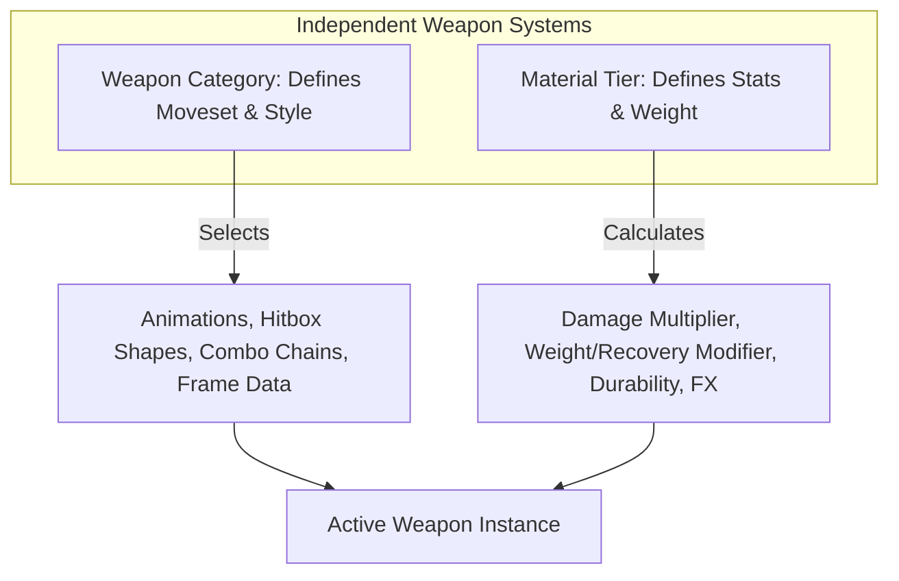

# SHADOWCRAFT 2D — PROJECT CONSTITUTION
**The Permanent Source of Truth & Project Governance**

> **Document Version:** 1.0.0  
> **Status:** APPROVED & ACTIVE  
> **Engine:** Godot 4 (Compatibility Renderer)  
> **Target Platform:** Windows 10/11 (64-bit)  
> **Last Updated:** 2026-11-09

---

## 1. GAME VISION

**ShadowCraft 2D** is an original, atmospheric 2D weapon-based shadow fighting game. It synthesizes the deliberate spacing, martial arts precision, and dojo-based progression of *Shadow Fight 2* with the intuitive weapon categorisation and material hierarchy inspired by *Minecraft*.

Two shadow warriors face each other across a fixed 2D side-view arena. Victory requires mastery of distance, frame timing, weapon weight, defensive parrying, and deliberate martial technique. Weapons are not mere damage multipliers; choosing a weapon fundamentally transforms the warrior's moveset, rhythm, range, and tactical identity.

---

## 2. CORE GAMEPLAY PILLARS

1. **Tactical 2D Spacing & Neutral Game:**
   Combat is determined by positional awareness, whiff punishment, and anticipation rather than frenetic button mashing. Every strike commits the character to frames of startup, active danger, and recovery.
2. **Weapon Identity Over Stat Inflation:**
   A weapon defines how the character moves and fights. A spear demands zone control and thrust spacing; an axe demands commitment to crushing overhead cleaves; a sword provides rapid, versatile fluid sequences; a mace inflicts devastating poise damage at close quarters.
3. **Atmospheric Shadow Aesthetic:**
   Deep, anatomically grounded silhouette figures accentuated by subtle anatomical gradients and controlled, high-contrast emissive energy (purple for Kai, crimson for Razen) against rich, cinematic 2D dojos and arenas.
4. **Deliberate Defensive Counterplay:**
   Combat rewards reading the opponent. Active high/low directional blocking, micro-spacing dodges, and precise parry windows create intense, high-stakes momentum shifts.
5. **Dojo Progression & Martial Mastery:**
   Players conquer progressively harder martial dojos, dueling masters and their bodyguards, acquiring new weapon categories, refining material tiers, and unlocking dojo challenges.

---

## 3. VISUAL IDENTITY

- **Silhouette Anatomy:** Characters are rendered as deep dark silhouettes with visible anatomical articulation, clothing folds, sash physics, and weapon profiles. They are distinct, readable human warriors—not generic blobs.
- **Controlled Emissive Accents:**
  - **Kai:** Resonant purple energy signatures, subtle violet eye glints, and ethereal blade trails.
  - **Razen:** Menacing crimson accents, fiery red eyes, and brutal crimson impact streaks.
- **Cinematic Lighting & Arenas:** Multi-layer 2D parallax backgrounds representing moonlit dojos, bamboo forests, stone courtyards, and volcanic fortresses. Dynamic 2D canvas lights (`PointLight2D`, `DirectionalLight2D`) cast soft ambient glow and rim lights along character silhouettes.
- **No 3D Visuals:** All visual assets are strictly 2D sprites, sprite sheets, skeletal 2D cutouts, and 2D particle systems (`GPUParticles2D` / `CPUParticles2D`).

---

## 4. 2D-ONLY TECHNICAL REQUIREMENTS

**Under no circumstances shall any 3D node, system, or asset be introduced into this project.**

- **Engine:** Godot 4 (v4.3 or higher, utilizing Godot 4.7.2 official release).
- **Renderer:** Godot Compatibility Renderer (`gl_compatibility`).
  - Strict reliance on OpenGL 3.3 / GLES3 pipelines.
  - Maximum compatibility on modest laptops, avoiding heavy Vulkan overhead.
- **Mandatory 2D Core Nodes:**
  - `CharacterBody2D` for kinematic character movement and physical boundary collisions.
  - `Area2D` with `CollisionShape2D` / `CollisionPolygon2D` for Hitboxes and Hurtboxes.
  - `Skeleton2D` and `Bone2D` for cut-out skeletal deformation.
  - `AnimationPlayer` and `AnimatedSprite2D` for frame-by-frame and skeletal blending.
  - `Camera2D` with custom framing script for dual-fighter tracking.
- **Strictly Prohibited:**
  - `CharacterBody3D`, `RigidBody3D`, `StaticBody3D`
  - `MeshInstance3D`, `Sprite3D`
  - `Camera3D`
  - 3D Physics engines (Jolt 3D, GodotPhysics3D)
  - 2.5D projection hacks or 3D scene viewports

---

## 5. COMBAT PHILOSOPHY

- **Frame-Discrete Execution:**
  Every attack is divided into three discrete phases:
  1. *Startup:* Wind-up frames before active hitboxes emerge (vulnerable to counter-hit).
  2. *Active:* Frames during which damage and poise reduction are applied upon collision with a hurtbox.
  3. *Recovery:* Cool-down frames during which the attacker cannot block or initiate new actions.
- **Hitbox / Hurtbox Precision:**
  - Hurtboxes precisely wrap the warrior's anatomical limbs (Head, Torso, Legs, Arms).
  - Hitboxes dynamically match the active trajectory and length of the weapon or striking limb.
- **Defense System:**
  - *Passive Neutral:* Walking backward activates high guard against standing strikes.
  - *Crouching Guard:* Defends against low sweeps but leaves head vulnerable to heavy overheads.
  - *Parry Window:* Activating defensive inputs within a tight 4-frame window deflects the attack, causes attacker recoil/stumble, and yields immediate frame advantage.
- **Hit Reactions & Poise:**
  - *Light Stagger:* Minor interrupt with brief frame disadvantage.
  - *Heavy Stagger:* Long recovery allowing combo linkage.
  - *Knockback:* Pushback distance proportional to attack weight and weapon tier.
  - *Knockdown:* Hard knockdown requiring grounded wake-up roll.

---

## 6. CHARACTER DESIGN PHILOSOPHY

Characters in ShadowCraft are distinct martial archetypes:

### Kai — The Shadow Disciple
- **Visual Identity:** Sleek, athletic silhouette, agile shinobi-disciple attire, flowing purple headband, subtle violet core glow.
- **Combat Identity:** High mobility, fast frame data, fluid transitions, versatile spacing, excels at counter-attacking and rapid sword combinations.

### Razen — The Crimson Warlord
- **Visual Identity:** Imposing, heavily armored warlord silhouette, flared shoulder pauldrons, jagged horns or crimson mask crest, radiating deep blood-red energy.
- **Combat Identity:** Heavy deliberate strikes, super-armor frames on select heavy attacks, devastating poise damage, punishing reach, excels at corner traps and wall splats.

---

## 7. WEAPON DESIGN PHILOSOPHY

Weapons are the cornerstone of gameplay variety. They are structured into two independent orthogonal vectors:

### Weapon Categories (Style & Moveset)
- **Sword:** Balanced slashing, quick stabs, double-strike combos, versatile neutral game.
- **Axe:** Powerful vertical chops, ground slams, armor-crushing overheads, wide arcs.
- **Spear:** Extended horizontal thrusts, retreating pokes, long-range zoning, poor close-in defense.
- **Mace:** Heavy blunt impacts, high poise depletion, shield-staggering strikes, devastating close-quarter knockdowns.

### Material Tiers (Material & Stat Scaling)
- **Wood:** Fragile, ultra-lightweight, rapid startup, lowest base damage.
- **Stone:** Moderate weight, balanced early-game baseline.
- **Iron:** Heavy, reliable durability, solid damage scaling, balanced recovery.
- **Diamond:** Hardened edge, high critical rate, clean swift recovery, superior damage.
- **Netherite:** Maximum weight and impact, impenetrable poise pressure, elite shadow infusion.

---

## 8. ANIMATION PHILOSOPHY: THE HYBRID STRATEGY

To achieve both fluidity and punchy martial impact, ShadowCraft utilizes a hybrid animation pipeline:

- **2D Skeletal Animation (`Skeleton2D` + `Bone2D`):**
  - Used for continuous, looping, or state-blended locomotion.
  - *Applications:* Idle breathing, walking forward/backward, running, guard raises, crouching transitions.
  - *Advantage:* Perfectly smooth interpolations, tiny memory footprint, modular weapon attachment to bone sockets.
- **Frame-by-Frame Sprite Animation (`AnimationPlayer` / Sprite Sheets):**
  - Used for snappy, high-impact martial arts combat.
  - *Applications:* Weapon swings, thrusts, aerial kicks, parry deflections, heavy impact recoils, knockdowns, and ground recovery rolls.
  - *Advantage:* Exaggerated martial arts smears, silhouette distortion, intentional weight and instant zero-frame acceleration impossible with pure skeletal interpolation.

---

## 9. PERFORMANCE TARGETS

ShadowCraft 2D is engineered to run flawlessly on modest, non-gaming Windows laptops:

- **Target Frame Rate:** Rock-solid **60 FPS** at all times.
- **Baseline Resolution:** **1280 × 720** (16:9 720p). Scalable to 1080p and 1440p via `canvas_items` stretch mode without subpixel distortion.
- **Frame Budget:** 16.6 milliseconds total frame time.
  - Logic & Physics: < 3.0 ms
  - Render & Draw: < 8.0 ms
  - Idle Headroom: > 5.0 ms
- **Memory Footprint:** < 350 MB RAM working set; < 256 MB VRAM.
- **Draw Calls:** Maintained below 50 draw calls per frame through efficient 2D sprite batching and shared atlases.

---

## 10. ORIGINALITY & INTELLECTUAL PROPERTY

- **Strict Originality Requirement:**
  ShadowCraft is an original intellectual property. *Shadow Fight 2* and *Minecraft* are referenced solely as gameplay and genre inspirations.
- **Prohibited Conduct:**
  - Zero copying, ripping, or reproducing of art assets, sprites, meshes, UI graphics, sound effects, or music from any third-party game.
  - Zero extraction or decompilation of third-party game code.
  - Zero use of copyrighted character names, logos, or trademarks.
- **Provenance Tracking:**
  Every asset introduced into the repository must have documented origin, creator, and license recorded in `docs/ASSET_GUIDELINES.md`.

---

## 11. CODING STANDARDS

- **Language:** GDScript 2.0 with mandatory static typing.
- **Strict Typing:** All variable declarations, function parameters, and return types must be explicitly typed. Untyped `var` is prohibited unless handling dynamic engine arrays where static typing is syntactically unsupported.
- **Class Registration:** Key reusable data types and components must be registered with `class_name` for easy resource instantiation and type checking.
- **Separation of Concerns:**
  - Logic nodes calculate states and emit signals.
  - Visual nodes listen to signals and trigger animations, particles, and screen shake.
  - Presentation never dictates game logic or combat resolution.
- **Data-Driven Architecture:** Custom `Resource` subclasses (`AttackData`, `WeaponData`, `CharacterData`) store all balances and definitions.

---

## 12. DOCUMENTATION STANDARDS

- All documentation resides in `docs/`.
- Every major architectural decision must be logged as an Architecture Decision Record in `docs/DECISIONS/ADR-xxxx.md`.
- Every phase must contain:
  1. `SPECIFICATION.md` (Scope, requirements, deliverables)
  2. `IMPLEMENTATION_PLAN.md` (Step-by-step engineering tasks)
  3. `TEST_PLAN.md` (Unit, integration, and manual acceptance tests)
  4. `COMPLETION_REPORT.md` (Audit results, verification proofs, metrics)
- `ROADMAP.md`, `TASK_BOARD.md`, `CHANGELOG.md`, and `NEXT_SESSION.md` must be kept strictly updated.

---

## 13. TESTING & QUALITY ASSURANCE

- **Framework:** **GdUnit4** is the official automated test framework.
- **Unit Testing:** All math functions, damage formulas, state machine transitions, and resource schemas must have automated unit tests.
- **Integration Testing:** Hitbox-hurtbox collisions, combo chains, and save/load serialization must be verified via automated integration tests.
- **Continuous Integration:** Headless automated test execution runs on Git commits via GitHub Actions.
- **Honesty in Verification:** Headless tests prove logic and mathematics. Visual and tactile qualities (game feel, input responsiveness, frame alignment) must be tested on a running display and clearly distinguished.

---

## 14. DEVELOPMENT WORKFLOW & PHASE APPROVAL

1. Development proceeds strictly through numbered phases (Phase 00 through Phase 12).
2. An agent may ONLY work on the current, user-authorized phase.
3. Upon completing all tasks in a phase, the agent must perform a **Two-Pass Audit**:
   - **Pass 1:** Architecture & Consistency.
   - **Pass 2:** Quality & Completeness.
4. The agent writes the `COMPLETION_REPORT.md` and updates `NEXT_SESSION.md`.
5. **Strict Stop Condition:** The agent MUST NOT proceed to the next phase without explicit, written user authorization.

---

## 15. EXPLICIT EXCLUSIONS

The following items are out of scope and strictly excluded from ShadowCraft 2D:

- Any 3D rendering, 3D physics, or 2.5D pipelines.
- Online peer-to-peer or client-server multiplayer (initial scope is strictly single-player / local duel).
- Microtransactions, gacha mechanics, energy meters, or loot boxes.
- Mobile touch overlays during core desktop development.
- Third-party bloated dependencies or unvetted asset packs.

